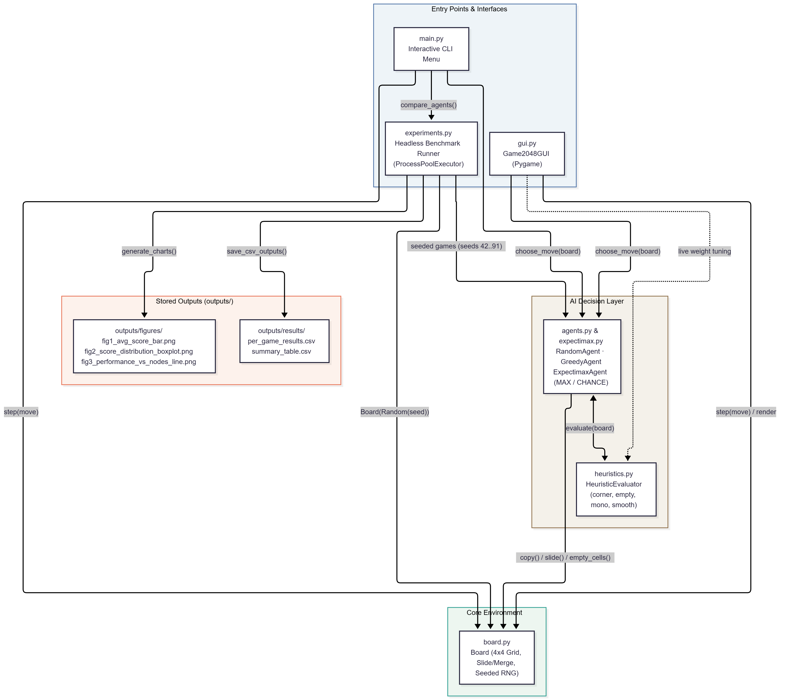
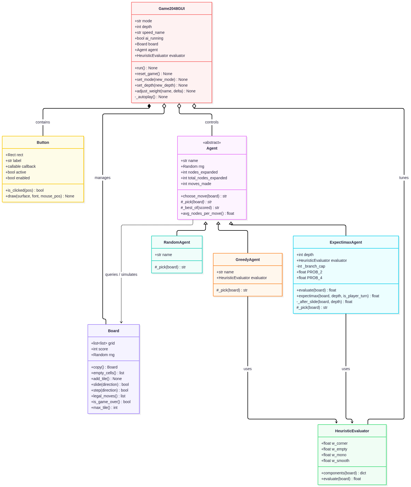
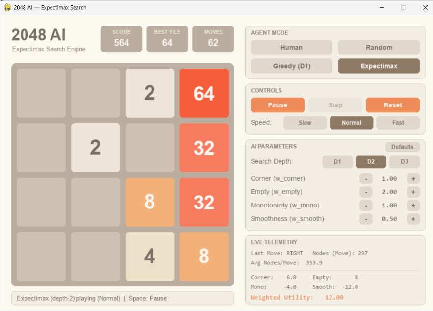
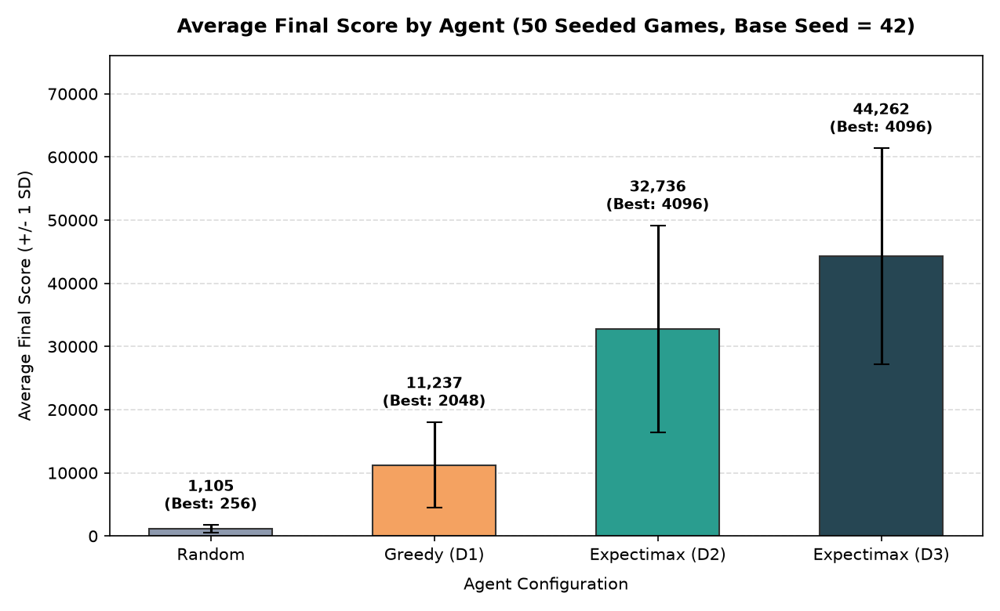
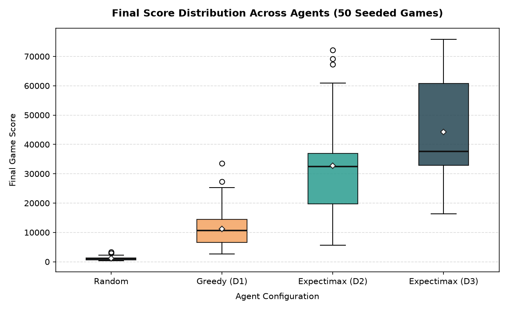
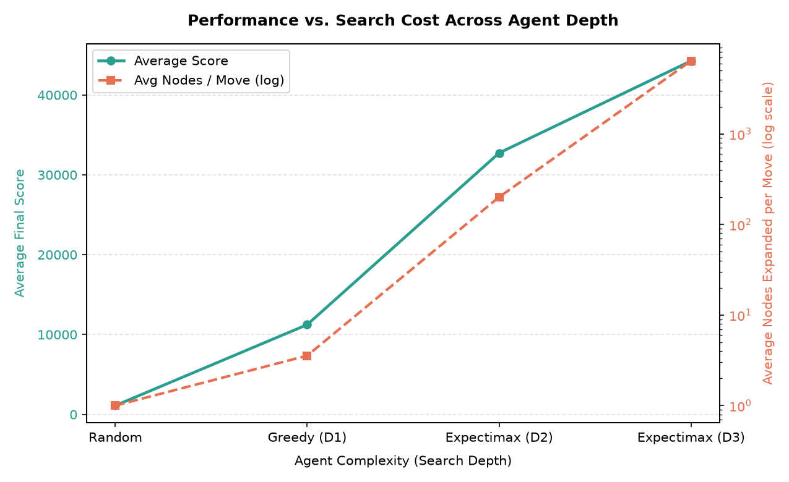

# 2048 AI with Expectimax — Project Report

**FAST — National University of Computer and Emerging Sciences**  
FAST School of Computing · Karachi Campus  
Department of Artificial Intelligence & Data Science  

**Course:** AL-2002 — Artificial Intelligence (Laboratory)  
**Programme / Semester:** BS Cybersecurity · 5th Semester  
**Session:** Fall 2026  
**Deliverable:** Semester Lab Project Report (Weightage: 2 marks)  

| Role | Student Name | Roll Number | Section |
| :--- | :--- | :--- | :--- |
| **Leader** | Muhammad Daniyal Alam | 24K-2048 | BCY-5A |

| Field | Details |
| :--- | :--- |
| **Project Idea** | Idea No. 6 from the Project Ideas list ☑ &nbsp; Own idea ☐ |
| **Category** | Part A — Game ☑ &nbsp; Part B — Applied / Data ☐ |
| **GitHub Repository** | <https://github.com/mdaniyalalam/2048-Expectimax-AI> |
| **Date of Submission** | November 21, 2026 |

---

## Table of Contents

- [Declaration and Contribution Statement](#declaration-and-contribution-statement)
- [1. Introduction](#1-introduction)
- [2. Problem Formulation](#2-problem-formulation)
- [3. System Design and Architecture](#3-system-design-and-architecture)
- [4. AI Techniques and Implementation](#4-ai-techniques-and-implementation)
- [5. Data and Experimental Setup](#5-data-and-experimental-setup)
- [6. Results and Analysis](#6-results-and-analysis)
- [7. Testing, Limitations and Ethics](#7-testing-limitations-and-ethics)
- [8. Individual Contributions and Conclusion](#8-individual-contributions-and-conclusion)
- [Appendix A — Setup and Execution](#appendix-a--setup-and-execution)

---

## Declaration and Contribution Statement

I declare that the work presented in this report is my own, that all external sources — code, datasets, libraries, tutorials, and AI assistance — have been acknowledged, and that I am able to explain all portions of the work attributed to me below.

| Member | Roll Number | Principal contribution (one line) | Share | Signature |
| :--- | :--- | :--- | :---: | :--- |
| Muhammad Daniyal Alam | 24K-2048 | Sole developer: full implementation of the 2048 game engine, Expectimax and baseline AI agents, heuristic evaluation, Pygame GUI, and benchmark experiments | 100% | *M. Daniyal Alam* |

---

## 1. Introduction

### 1.1 Overview

This project presents a complete, playable desktop implementation of the sliding-tile puzzle game 2048 paired with an autonomous artificial intelligence solver built in Python and Pygame. The system supports both interactive manual play and automated AI execution, making it useful for puzzle enthusiasts who want to play or observe high-level strategies, as well as students and developers studying sequential decision-making under uncertainty.

In 2048, sliding tiles on a 4×4 grid is complicated by stochasticity: after every valid move, the environment randomly spawns a new tile of value 2 (90% probability) or 4 (10% probability) in any empty cell. Because future board states cannot be predicted deterministically, standard search algorithms fail to capture the probabilistic nature of the game. To address this, the system implements a depth-limited Expectimax search agent that alternates between maximizing player moves and computing the expected utility across random tile spawns. Guided by a weighted multi-heuristic evaluation function (incorporating corner anchoring, empty-cell preservation, monotonicity, and smoothness), the agent consistently navigates uncertainty to reach high-value tiles such as 2048 and 4096, far outperforming greedy and random baselines.

### 1.2 Objectives and Scope

| # | Objective | Achieved? |
| :-: | :--- | :-: |
| 1 | Implement a complete, playable 2048 game engine and Pygame desktop interface supporting both manual keyboard play and automated AI execution. | ☑ |
| 2 | Implement a custom, depth-limited Expectimax search agent guided by a four-component weighted heuristic evaluation function (corner anchoring, empty tiles, monotonicity, and smoothness) entirely from scratch in Python. | ☑ |
| 3 | Outperform Random and Greedy (Depth-1) baselines across 50 seeded games (seeds 42–91), with Expectimax Depth-2 reaching the 2048 tile in at least 70% of games (achieved: 74.0%) and Depth-3 in at least 85% of games (achieved: 90.0%), compared to 10.0% for Greedy and 0.0% for Random. | ☑ |
| 4 | Provide a reproducible headless benchmarking suite that exports CSV results and generates three labelled Matplotlib charts comparing score performance, score variance, and computational cost (nodes expanded). | ☑ |

**Out of scope and known limitations:** Search depths of 4 or higher and web/mobile deployment are deliberately excluded; the system operates strictly as a local desktop application. As a known limitation, Expectimax Depth-3 expands an average of 6,406 nodes per move (~225 seconds per full game), creating noticeable move delays during live GUI play compared to Depth-2 (~5.2 seconds per full game).

---

## 2. Problem Formulation

### 2.1 Problem Statement

This project addresses sequential decision-making under uncertainty, modeled through the sliding-tile puzzle game 2048. Solving 2048 is computationally difficult due to both its vast search space and its stochastic transition mechanics. At each turn, the agent chooses from up to four directional moves, after which the environment randomly spawns a 2 (90% probability) or a 4 (10% probability) in any empty cell. With up to 15 empty cells available, a single player move can branch into as many as 30 immediate chance outcomes; looking just three moves ahead expands the search tree into hundreds of thousands of probabilistic states, making brute-force enumeration and deterministic search impractical. Furthermore, the agent must balance competing constraints—such as merging tiles to free space while keeping high-value tiles ordered and anchored in a corner. For example, given a mid-game board with a 1024 tile anchored in a corner and several scattered 64 and 128 tiles, the system must evaluate whether an immediate merge is worth the risk of a random tile spawning in a position that dislodges the corner anchor or blocks future chains.

### 2.2 PEAS Description and Environment

| Component | Description |
| :--- | :--- |
| **Performance measure** | Highest tile reached before Game Over (e.g., 2048, 4096); secondary: cumulative merge score and moves survived. |
| **Environment** | 4×4 grid of empty cells or power-of-2 tiles; after each valid move, spawns a `2` (90%) or `4` (10%) in a random empty cell. |
| **Actuators** | Four discrete moves (Up, Down, Left, Right) sliding all tiles and merging adjacent equal values. |
| **Sensors** | Complete read access to the 4×4 matrix (exact tile values and coordinates). |

| Property | Classification | One-line justification |
| :--- | :--- | :--- |
| **Observability** | Fully ☑ &nbsp; Partially ☐ | Full 4×4 grid and all tile values are visible at every step. |
| **Determinism** | Deterministic ☐ &nbsp; Stochastic ☑ | Tile slides are deterministic, but new tile positions and values (`2` or `4`) are random. |
| **Change over time** | Static ☑ &nbsp; Dynamic ☐ | The board remains unchanged while the agent deliberates. |
| **State and actions** | Discrete ☑ &nbsp; Continuous ☐ | Grid coordinates, power-of-2 tile values, and four moves are finite and discrete. |
| **Agents** | Single ☑ &nbsp; Multi / adversarial ☐ | Single rational agent; random spawns are chance events, not an adversary. |
| **Agent type** | Utility-based | Maximizes expected multi-heuristic utility over a probabilistic lookahead tree. |

### 2.3 Problem Representation

| Element | Representation in code |
| :--- | :--- |
| **State representation** | A 4×4 integer matrix where each cell contains either empty (`0`) or a power of 2 representing a tile's current value. |
| **Actions / moves** | Four discrete directional moves: Up, Down, Left, and Right. |
| **Initial state** | A 4×4 matrix initialized with mostly empty cells and exactly two randomly placed tiles (each carrying a 90% probability of being a `2` and a 10% probability of being a `4`). |
| **Goal or terminal test** | The terminal test is triggered when the board is in a "Game Over" state, meaning there are zero empty cells left and no adjacent tiles horizontally or vertically share the same value to allow a merge. |
| **Cost, utility, fitness or evaluation** | A custom utility function evaluated at the leaf nodes of the search tree. It calculates a weighted sum based on four heuristics: anchoring the maximum tile in a corner, maximizing empty cell count, maintaining grid monotonicity, and penalizing adjacent tile variance (smoothness). |

---

## 3. System Design and Architecture

### 3.1 Overall Architecture

The system follows a modular, layered architecture that separates the core 2048 game engine from AI decision-making, user interfaces, and benchmarking. At the foundation, `Board` (`board.py`) maintains the 4×4 grid state, tile-sliding mechanics, and seeded random tile spawning. AI agents (`RandomAgent`, `GreedyAgent`, and `ExpectimaxAgent`) receive a read-only or copied `Board` instance, simulate candidate moves, and consult `HeuristicEvaluator` (`heuristics.py`) to score leaf states.

Three entry points drive this core: `gui.py` provides an interactive Pygame desktop interface with live parameter tuning and telemetry; `main.py` offers a menu-driven terminal interface for manual play, live AI observation, and interactive benchmarking; and `experiments.py` runs headless, multi-process seeded simulations across all agents. During benchmarking, per-game metrics flow from `_play_single_game()` into `summarize()`, which exports `per_game_results.csv` and `summary_table.csv` to `outputs/results/` and generates three Matplotlib figures in `outputs/figures/`.



*Figure 3.1: System architecture*

### 3.2 Class Design



*Figure 3.2: Class diagram*

| Class | Responsibility | Inherits from | Key methods |
| :--- | :--- | :--- | :--- |
| **`Board`** (`board.py`) | 4×4 grid state, directional sliding/merging, seeded spawning, game-over check. | `object` | `slide()`, `step()`, `add_tile()`, `copy()`, `legal_moves()`, `is_game_over()`, `max_tile()` |
| **`HeuristicEvaluator`** (`heuristics.py`) | Computes four log2-scaled heuristics (corner, empty, mono, smooth) and weighted utility. | `object` | `components()`, `evaluate()` |
| **`Agent`** (`agents.py`) | Abstract base class with seeded RNG, node counters, and random tie-breaking. | `object` | `choose_move()`, `_pick()`, `_best_of()`, `avg_nodes_per_move()` |
| **`RandomAgent`** (`agents.py`) | Uniformly picks a random legal move. | `Agent` | `_pick()` |
| **`GreedyAgent`** (`agents.py`) | Depth-1 baseline maximizing immediate post-slide heuristic utility. | `Agent` | `_pick()` |
| **`ExpectimaxAgent`** (`expectimax.py`) | Depth-limited recursive Expectimax over MAX/CHANCE nodes with branch capping. | `Agent` | `_pick()`, `expectimax()`, `_after_slide()`, `evaluate()` |
| **`Game2048GUI`** (`gui.py`) | Pygame event loop, Human/AI playback, live parameter controls, and telemetry. | `object` | `run()`, `_autoplay()`, `_apply_move()`, `set_mode()`, `set_depth()`, `adjust_weight()` |
| **`Button`** (`gui.py`) | Clickable UI button with hover, active, and disabled states. | `object` | `is_clicked()`, `draw()` |

**OOP Principles Demonstrated:**

| Principle | Where it is demonstrated in code |
| :--- | :--- |
| **Encapsulation** | `Board` hides grid transforms behind `slide()`, `step()`, and `_slide_row_left()`; `ExpectimaxAgent` hides `_branch_cap` and exposes weights via `@property` descriptors. |
| **Inheritance** | `RandomAgent`, `GreedyAgent`, and `ExpectimaxAgent` inherit from `Agent`, reusing `choose_move()`, `_best_of()`, `avg_nodes_per_move()`, and `super().__init__(seed)`. |
| **Method overriding** | All three agent subclasses override `Agent._pick()` to define distinct move-selection logic. |
| **Polymorphism** | `watch_ai()`, `_play_single_game()`, and `Game2048GUI._autoplay()` call `agent.choose_move(board)` uniformly across any `Agent` subclass. |

---

## 4. AI Techniques and Implementation

### 4.1 Module Overview

| File | Responsibility | Author |
| :--- | :--- | :--- |
| `src/main.py` | Interactive CLI for human play, live AI viewing, and benchmarks. | Muhammad Daniyal Alam |
| `src/gui.py` | Pygame desktop GUI (`Game2048GUI`, `Button`) with live controls and telemetry. | Muhammad Daniyal Alam |
| `src/board.py` | 4×4 `Board` environment, slide/merge transforms, and seeded tile spawning. | Muhammad Daniyal Alam |
| `src/agents.py` | Abstract `Agent` base class, `RandomAgent`, and `GreedyAgent`. | Muhammad Daniyal Alam |
| `src/expectimax.py` | Recursive MAX/CHANCE `ExpectimaxAgent` with chance-branch capping. | Muhammad Daniyal Alam |
| `src/heuristics.py` | `HeuristicEvaluator` for log2-scaled board utility. | Muhammad Daniyal Alam |
| `src/experiments.py` | Multi-process seeded benchmark runner, CSV exporter, and Matplotlib plotter. | Muhammad Daniyal Alam |
| `src/cli_utils.py` | Terminal clearing, `ValueError`-safe input (`ask`), and pausing. | Muhammad Daniyal Alam |

### 4.2 Technique Details

#### Technique 1 — Expectimax Search (Core AI)

| Field | Details |
| :--- | :--- |
| **Name** | Depth-Limited Expectimax Search (`ExpectimaxAgent`) |
| **Own code or library** | Own code (implemented from scratch in `src/expectimax.py` and `src/heuristics.py`) |
| **Heuristic, evaluation, fitness or model** | Custom weighted multi-heuristic utility function (`HeuristicEvaluator.evaluate`) over log2-scaled tile values: U(s) = w_corner x h_corner + w_empty x h_empty + w_mono x h_mono + w_smooth x h_smooth. Terminal dead-end states with no legal moves return `-1000.0`. |
| **Key parameters and values used** | `depth=2` (uncapped) and `depth=3` (`max_chance_branches=6`); `PROB_2=0.9`, `PROB_4=0.1`; weights `1.0`, `2.0`, `1.0`, `0.5`. |
| **Time and space cost** | Time: `O(b_m^d · b_c^(d-1))` per move, where `b_m ≤ 4` is the number of legal moves, `d` is search depth in player turns, and `b_c = 2k` is the chance branching factor (`k` empty cells, capped at `k ≤ 6` for `d ≥ 3`). Empirically ~200.9 nodes/move at Depth-2 and ~6,405.5 nodes/move at Depth-3. Space: `O(d)` recursion stack depth (chance nodes mutate the grid in place rather than copying). |

#### Technique 2 — Greedy Heuristic Search (Depth-1 Baseline)

| Field | Details |
| :--- | :--- |
| **Name** | Depth-1 Greedy Heuristic Search (`GreedyAgent`) |
| **Own code or library** | Own code (implemented from scratch in `src/agents.py`) |
| **Heuristic, evaluation, fitness or model** | Same `HeuristicEvaluator`, applied immediately post-slide without chance nodes. |
| **Key parameters and values used** | Depth 1; default weights (`1.0`, `2.0`, `1.0`, `0.5`); seeded tie-breaking. |
| **Time and space cost** | Time `O(b_m)` (avg 3.56 nodes/move); Space `O(1)`. |

#### Technique 3 — Random Play (Control Baseline)

| Field | Details |
| :--- | :--- |
| **Name** | Uniform Random Play (`RandomAgent`) |
| **Own code or library** | Own code (implemented from scratch in `src/agents.py`) |
| **Heuristic, evaluation, fitness or model** | None; uniform random choice from `board.legal_moves()`. |
| **Key parameters and values used** | Seeded `random.Random(seed)` instance for reproducible move selection. |
| **Time and space cost** | Time `O(b_m)` (1 logged node/move); Space `O(1)`. |

### 4.3 Key Implementation Details

```python
        cap = self.max_chance_branches
        if cap is not None and len(empty) > cap:
            empty = self.rng.sample(empty, cap)

        cell_prob = 1.0 / len(empty)
        total = 0.0
        for r, c in empty:
            board.grid[r][c] = 2
            u2 = self.expectimax(board, depth, is_player_turn=True)
            board.grid[r][c] = 4
            u4 = self.expectimax(board, depth, is_player_turn=True)
            board.grid[r][c] = 0
            total += cell_prob * (self.PROB_2 * u2 + self.PROB_4 * u4)
        return total
```

Instead of adversarial Minimax pruning, this CHANCE node averages recursive MAX-node utilities weighted by `0.9` (tile `2`) and `0.1` (tile `4`) across empty cells. Two optimizations keep pure-Python search practical: (1) **in-place mutation**, writing `2` and `4` directly to `board.grid[r][c]` and restoring `0` afterward instead of copying the board per branch; and (2) **seeded branch capping**, sampling at most `max_chance_branches = 6` empty cells via `self.rng.sample()` at Depth-3 to prevent exponential blowup while preserving exact determinism.

---

## 5. Data and Experimental Setup

### 5.1 Data or Environment Source

| Field | Details |
| :--- | :--- |
| **Dataset / environment name** | Self-contained 2048 Python Simulation Environment (`src/board.py`) |
| **Link (required for a public dataset or API)** | N/A — procedurally generated environment |
| **Type** | Public dataset ☐ &nbsp; Web API ☐ &nbsp; Self-collected ☐ &nbsp; Generated ☑ |
| **Size** | **Records / instances:** 200 complete simulated games (50 per agent for 4 agents)<br>**Files / size on disk:** 2 CSV result files (`per_game_results.csv`: 10.6 KB; `summary_table.csv`: 456 B) |
| **Fields or instance description** | Each instance is a 4×4 integer matrix initialized with two randomly spawned tiles (90% `2`, 10% `4`) and played until terminal Game Over. Logged fields per game: `agent`, `seed`, `score`, `max_tile`, `moves`, `avg_nodes`, and `time_s`. |
| **Licence / terms of use** | Original student code (open-source `LICENSE` committed in repository; no third-party dataset restrictions) |
| **Cleaning or preprocessing applied** | None required for raw environment states |
| **Offline caching** | Runs 100% offline with zero network calls; benchmark CSV tables and charts are written locally to `outputs/results/` and `outputs/figures/` |

**Details of generated data:** All experimental instances were generated procedurally by the author in November 2026 using the `Board` simulator (`src/board.py`) and the headless benchmark runner (`src/experiments.py`). For each of the four agent configurations, 50 full games were simulated from deterministic integer seeds 42 through 91 (200 total game records), ensuring that every agent started on identical initial boards with reproducible tile-spawn streams. Because the environment is entirely synthetic and self-contained, no external permissions were required; both the generator scripts (`src/board.py`, `src/experiments.py`) and the resulting CSV logs (`outputs/results/`) are committed to the repository.

### 5.2 Experimental Setup

| Parameter | Configuration |
| :--- | :--- |
| **What is compared** | Four agent configurations: `Random`, `Greedy (D1)`, `Expectimax (D2)`, and `Expectimax (D3)` (with Depth-3 chance-node branching capped at 6 sampled empty cells). All heuristic-based agents share identical default weights (`w_corner=1.0`, `w_empty=2.0`, `w_mono=1.0`, `w_smooth=0.5`). |
| **Metric(s)** | Average, standard deviation, and median final game score; average and maximum highest tile reached; percentage of games reaching >= 1024 and >= 2048; average moves survived; average search nodes expanded per move; and average CPU time per game (`time.process_time()`). |
| **Baseline** | Two baselines: `RandomAgent` (uniformly random legal moves, measuring basic competence) and `GreedyAgent` (Depth-1 heuristic maximization without chance-node lookahead, isolating the value of multi-step Expectimax planning). |
| **Test instances / test set** | Complete 4×4 2048 games simulated from the initial two-tile spawn until a terminal Game Over state is reached. |
| **Number of runs and random seed** | 50 complete games per agent (200 games total) using fixed sequential seeds 42 to 91 (`base_seed = 42`, `seed = base_seed + i` for `i = 0..49`), passed independently to both `Board(random.Random(seed))` and each agent's isolated RNG. Executed in parallel via `ProcessPoolExecutor` (`CPU cores - 1` workers). |
| **Machine and Python version** | AMD Ryzen 5 2600, 16 GB RAM, Python 3.13.9; external dependencies: `pygame==2.6.1`, `matplotlib==3.9.2`. |

---

## 6. Results and Analysis

### 6.1 Program Output



*Figure 6.1: The application in use*

### 6.2 Comparison of Approaches

| Technique / configuration | Avg Score (± SD) | Median Score | Best Tile | % ≥ 1024 | % ≥ 2048 | Avg Nodes / Move | Avg CPU Time / Game | Notes |
| :--- | :---: | :---: | :---: | :---: | :---: | :---: | :---: | :--- |
| **Baseline: Random** | 1,105 (± 603) | 1,070 | 256 | 0.0% | 0.0% | 1.0 | 0.006s | Uniform random legal move; avg 118.7 moves. |
| **Baseline: Greedy (D1)** | 11,237 (± 6,774) | 10,668 | 2048 | 52.0% | 10.0% | 3.6 | 0.060s | Immediate heuristic utility only; no chance-node lookahead. |
| **Expectimax (D2)** | 32,736 (± 16,386) | 32,452 | 4096 | 94.0% | 74.0% | 200.9 | 5.231s | Full chance enumeration; reached 4096 in 18% of games (9/50). |
| **Expectimax (D3)** | 44,262 (± 17,096) | 37,566 | 4096 | 100.0% | 90.0% | 6,405.5 | 224.967s | Chance nodes capped at 6 empty cells; reached 4096 in 38% of games (19/50). |

### 6.3 Visualisations



*Figure 6.2: Average final score (±1 standard deviation) and highest tile reached across 50 seeded games per agent.*

This bar chart compares the mean final score and best tile achieved by all four agents on identical seeded boards. Expectimax (D2) nearly triples the average score of the Greedy (D1) baseline (32,736 vs. 11,237), while Expectimax (D3) pushes the mean a further 35.2% higher to 44,262, confirming that modeling stochastic tile spawns yields substantial performance gains.



*Figure 6.3: Distribution of final game scores across 50 seeded runs (box = IQR, line = median, diamond = mean).*

This box plot illustrates score consistency and spread across all 50 games for each agent. Even Expectimax (D3)’s lower quartile (Q1 = 32,912) exceeds Expectimax (D2)’s median (32,452), while the wide upper quartile (Q3 = 60,734) reflects the large discrete score jump between runs ending at the 2048 tile versus those breaking through to 4096.



*Figure 6.4: Trade-off between average final score (left axis) and average nodes expanded per move on a logarithmic scale (right axis).*

This dual-axis line chart highlights the diminishing returns between search depth and computational effort. Advancing from Greedy (D1) to Expectimax (D2) increases mean score by 2.91× for only ~201 nodes per move, whereas stepping up to Depth-3 requires 31.9× more nodes per move (6,406) for a comparatively modest 35.2% score gain.

### 6.4 Discussion

Expectimax (D3) achieved the strongest overall performance, averaging 44,262 points, reaching at least 1024 in 100% of games, 2048 in 90%, and 4096 in 38%. This aligns directly with the stochastic problem formulation in Chapter 2: because 2048 spawns random 2 and 4 tiles after every move, evaluating expected utility over chance nodes allows the agent to preserve empty cells and protect corner-anchored tile chains rather than making shortsighted merges.

However, the speed–quality trade-off is steep. Moving from Depth-2 to Depth-3 improves average score by 35.2% but demands 31.9× more nodes per move and 43.0× more CPU time per game (225.0s vs. 5.2s), making Depth-2 the clear practical sweet spot for live interactive play. One pleasant surprise was how capable the Greedy (D1) baseline proved (11,237 mean score; 10% reaching 2048), demonstrating the strength of the `log₂`-scaled heuristic alone. Paired `t`-tests across the 50 matched seeds confirm the gains are far beyond chance (`p < 10⁻¹¹` for D2 vs. Greedy; `p = 0.0028` for D3 vs. D2).

---

## 7. Testing, Limitations and Ethics

### 7.1 Test Cases

| # | Test case | Expected | Actual | Pass |
| :-: | :--- | :--- | :--- | :-: |
| 1 | Normal input — typical run | GUI runs interactively; benchmark completes 200 games, creates CSVs and 3 PNG charts. | GUI ran at 60 FPS across all 4 modes; benchmark exported both CSVs and all 3 charts. | ☑ |
| 2 | Data or cache file missing | Missing `outputs/` folders auto-created without `FileNotFoundError`. | `mkdir(parents=True, exist_ok=True)` recreated `outputs/results/` and `outputs/figures/` cleanly. | ☑ |
| 3 | Invalid input typed by the user | CLI falls back to defaults; invalid API args raise `ValueError` or exit cleanly. | `ask()` defaulted on `ValueError`; invalid direction/depth raised `ValueError`; `--games 0` exited via `SystemExit`. | ☑ |
| 4 | Instance with no solution (no path, unsolvable puzzle, full board) | `is_game_over()` returns `True`, `choose_move()` returns `None`, GUI halts with overlay. | Terminal state detected; autoplay stopped and Game Over overlay displayed final stats. | ☑ |
| 5 | Search reaches its time or depth limit | Recursion stops at `depth == 0` (or `1` post-slide); D3 caps chance nodes at 6 cells. | Search terminated reliably at limit; D3 averaged 6,405.5 nodes/move without hanging. | ☑ |

### 7.2 Exception Handling

| Exception | Where it is caught | What the user sees |
| :--- | :--- | :--- |
| **`FileNotFoundError`** | Prevented in `save_csv_outputs()` and `generate_charts()` (`experiments.py`) via `mkdir(parents=True, exist_ok=True)`. | Missing directories are created silently and output paths print normally. |
| **`ValueError`** | Caught in `ask()` (`cli_utils.py`); raised on bad args in `Board.slide()`, `ExpectimaxAgent.__init__()`, and `_make_agent()`. | CLI silently falls back to defaults; API calls display a clear error message. |
| **`ImportError`** | Caught on `pygame` import (`gui.py`) and `matplotlib` import (`experiments.py`). | Clean `SystemExit` with exact `pip install` command. |

### 7.3 Limitations and Ethical Considerations

The AI’s primary limitation is exponential search-tree growth at deeper lookaheads. Even with Depth-3 chance-node branching capped at 6 sampled empty cells, pure-Python evaluation averages ~6,406 nodes per move (~225 seconds per game), making Depth-4+ impractical for real-time play. Additionally, sampling only 6 cells introduces minor approximation noise on open boards, and static heuristic weights cannot adapt dynamically between early-game and endgame (2048+/4096+) states.

Because the system runs 100% offline on procedurally generated 4×4 grids, it collects no personal user data, requires no external consent, and introduces no demographic bias or fairness risks. The consequence of a suboptimal move is strictly benign—a lower score or earlier Game Over in a single-player puzzle. Users should simply be informed that Depth-3 causes noticeable GUI latency and that Expectimax maximizes *expected* utility rather than guaranteeing a 2048 or 4096 win on every random seed.

---

## 8. Individual Contributions and Conclusion

| Member | Modules / files owned | Specific work done | Commits | Share |
| :--- | :--- | :--- | :---: | :---: |
| Muhammad Daniyal Alam (`24K-2048`) | All modules/files | Full solo implementation: 4×4 2048 engine, 4-component log2 heuristic evaluator, Random/Greedy/Expectimax agents, Pygame GUI with live telemetry and parameter tuning, CLI menu, multi-process seeded benchmark and charting pipeline, and project documentation. | 15 | 100% *(Solo Project)* |

### 8.1 Challenges Faced

**Expectimax Depth-3 Runtime Bottleneck:** Unoptimized Depth-3 expanded every empty cell across two chance layers (up to 28 branches per layer), stalling 50-game benchmarks in pure Python. I resolved this by capping chance nodes to `max_chance_branches = 6` via seeded `rng.sample()`, mutating and restoring `board.grid[r][c]` in place rather than copying boards per branch, precomputing `_LOG2` in `heuristics.py`, and parallelizing runs with `ProcessPoolExecutor` in `experiments.py`.

**Balancing Heuristic Weights:** Raw tile values grow exponentially and initially drowned out empty-cell and smoothness penalties; overweighting `w_empty` broke corner anchoring, while overweighting `w_corner` or `w_mono` caused early lock-ups. Normalizing tiles with log2 placed all four terms on one scale, and iterative seeded tuning via the GUI's live weight controls converged on `w_corner=1.0`, `w_empty=2.0`, `w_mono=1.0`, `w_smooth=0.5`.

### 8.2 Conclusion and Future Work

All four objectives in Section 1.2 were achieved: the project delivers a playable 2048 engine with a Pygame desktop interface, a custom pure-Python Expectimax solver guided by a four-component log2 heuristic, and a reproducible multi-core benchmarking suite. Across 50 seeded games (seeds 42–91), Expectimax Depth-2 reached the 2048 tile in 74.0% of runs (mean score 32,736) and Depth-3 reached 2048 in 90.0% and 4096 in 38% (mean score 44,262), decisively outperforming both Greedy Depth-1 (10.0% at 2048; mean 11,237) and Random play (0.0%; mean 1,105).

With more time, three concrete improvements would push the solver further:

1. **Bitboard representation and transposition tables:** Packing the 4×4 grid into a 64-bit integer and caching repeated states via Zobrist hashing would drastically reduce move latency and make Depth-4+ practical.
2. **Probability-cutoff pruning:** Pruning ultra-low-probability branches (such as consecutive 4-tile spawns) would allow deeper search along likely trajectories without sampling noise.
3. **Phase-adaptive heuristic weights:** Tuning separate weight profiles for early-game building versus endgame (2048+/4096+) survival (or optimizing weights automatically via evolutionary search) would further improve consistency.

---

## Appendix A — Setup and Execution

```bash
# 1. Clone the repository
git clone https://github.com/mdaniyalalam/2048-Expectimax-AI.git
cd 2048-Expectimax-AI

# (Optional) Create and activate a virtual environment
python -m venv venv
# Windows:
venv\Scripts\activate
# macOS / Linux:
source venv/bin/activate

# 2. Install pinned dependencies (pygame==2.6.1, matplotlib==3.9.2)
pip install -r requirements.txt

# 3. Run the application
python src/gui.py                         # Graphical Pygame interface (recommended)
python src/main.py                        # Interactive console menu (CLI)

# 4. Reproduce the results and charts
python src/experiments.py --games 50 --seed 42
```

**Additional Requirements and Notes:**

- **Configuration files and API keys:** None required. The system operates 100% offline with no external services, API keys, or local configuration files.
- **Dataset:** No external dataset is needed. All 200 benchmark games (50 per agent) are procedurally generated in-memory using deterministic integer seeds inside `src/board.py` and `src/experiments.py`.
- **Experiment runtime:** Expectimax Depth-3 averages ~225.0 CPU seconds per game. Using the default multi-core runner (`ProcessPoolExecutor` with `CPU cores - 1` workers, adjustable via `--workers N`), the full 50-game benchmark across all four agents takes roughly 15–30 minutes of wall-clock time depending on core count. For a quick verification run that skips Depth-3, pass `--no-depth3` (completes in under 1–2 minutes); pass `--no-charts` to export CSVs only.
- **Python version:** Requires Python 3.10 or higher (developed and tested against Python 3.13.9).

---

*End of Project Report*
